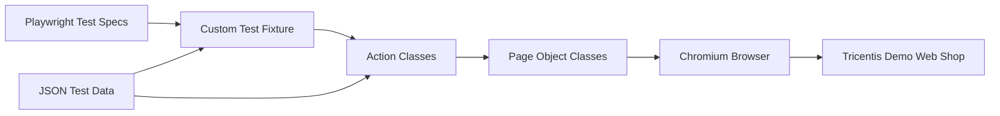

# Demo Web Shop Playwright Automation Suite

## Project Overview

This repository contains an end-to-end browser automation suite for the [Tricentis Demo Web Shop](https://demowebshop.tricentis.com/). It is built with Playwright Test and TypeScript and covers customer-facing shopping workflows, including registration, login, search, cart management, category navigation, wishlist, coupon validation, sorting, newsletter subscription, product comparison, and checkout.

The suite follows the **Page Object Model (POM)** pattern. Each application page has a dedicated Page Object class that contains its Playwright locators, while Action classes encapsulate reusable interactions and assertion workflows. This separation keeps locators, browser actions, and test scenarios maintainable and easy to update.

## Key Features

- User registration and gender selection
- Valid and invalid login validation
- Product search and search result verification
- Category navigation across Books, Computers, Electronics, and Apparel & Shoes
- Add, view, update, and remove products in the shopping cart
- Wishlist interaction
- Invalid coupon-code validation
- Product sorting by name and price
- Newsletter subscription
- Product comparison
- End-to-end checkout flow with check/money order payment
- HTML test reporting
- Chromium test execution
- Trace capture on the first retry
- GitHub Actions CI for pushes and pull requests

## Technology Stack

| Technology | Purpose |
|---|---|
| Playwright Test | Browser automation and test runner |
| TypeScript | Test implementation and type safety |
| Node.js | Runtime for Playwright and package scripts |
| Chromium | Primary configured browser project |
| JSON | Central test-data configuration |
| GitHub Actions | Continuous integration |
| HTML Reporter | Playwright test report generation |

The project requires Node.js 20 or later, as specified by the installed Playwright package dependencies.

## Project Architecture



The test architecture has three main implementation layers:

1. **Test specs** - Define test scenarios and assertions.
2. **Action classes** - Encapsulate reusable user workflows.
3. **Page classes** - Centralize locators and page structure.

The custom fixture creates every action object for a test and opens the configured Demo Web Shop URL automatically through `gotoBaseUrl`.

## Folder Structure

```text
.
|-- .github/
|   `-- workflows/
|       `-- playwright.yml
|-- src/
|   |-- Action/          # Reusable high-level browser workflows
|   |-- Fixture/         # Playwright custom fixture and action initialization
|   |-- Page/            # Page Object locators
|   `-- Testdata/        # JSON-based test data
|-- tests/
|   `-- registration-test.spec.ts
|-- .gitignore
|-- package.json
|-- package-lock.json
`-- playwright.config.ts
```

## Installation and Setup

### Prerequisites

- Node.js 20 or later
- npm
- Internet access to the public Demo Web Shop

### 1. Clone the Repository

```bash
git clone <repository-url>
cd demowebshop
```

### 2. Install Dependencies

```bash
npm ci
```

### 3. Install the Chromium Browser

```bash
npx playwright install chromium
```

For a Linux environment that requires system browser dependencies:

```bash
npx playwright install --with-deps chromium
```

## Environment Variables

The repository does not currently define or consume any active environment variables. Playwright configuration includes commented-out examples for dotenv and CI-based settings, but these integrations are not enabled.

The application base URL and test values are read from `src/Testdata/registration.json` instead of environment variables.

## Database Configuration

This project does not contain a database configuration or database integration. It tests the hosted Tricentis Demo Web Shop and depends on the application's externally managed data.

Test registration and login credentials are repository test inputs; real customer or application database credentials are not implemented in this project.

## How to Run the Project

Run the full suite with Chromium:

```bash
npx playwright test
```

Run a specific test file:

```bash
npx playwright test tests/registration-test.spec.ts
```

Run tests in headed mode:

```bash
npx playwright test --headed
```

Run a specific test by title:

```bash
npx playwright test -g "TC01-User Registration"
```

Open the generated HTML report:

```bash
npx playwright show-report
```

The Playwright report is written to `playwright-report/`, and test failures may generate files under `test-results/`. Both directories are ignored by Git.

## API Documentation

This repository does not implement or expose a custom REST or GraphQL API. The suite interacts with the existing Demo Web Shop through browser navigation and HTTP requests issued by the application.

The cart workflow observes the application's add-to-cart endpoint and waits for an HTTP 200 response from a URL containing `/addproducttocart`. Cart update and removal workflows similarly wait for successful `/cart` responses.

| Application Area | Observed Route |
|---|---|
| Home | `/` |
| Registration | `/register` |
| Login | `/login` |
| Search | `/search` |
| Books | `/books` |
| Computers | `/computers` |
| Electronics | `/electronics` |
| Apparel & Shoes | `/apparel-shoes` |
| Shopping Cart | `/cart` |
| Wishlist | `/wishlist` |
| Product Comparison | `/compareproducts` |

These routes are test targets only; this repository does not contain server-side API implementations or API contracts.

## Screenshots

No screenshot assets are currently committed to the repository.

Captured Playwright artifacts, if available after execution, can be found in `test-results/` or `playwright-report/`. The project is also configured to capture a trace on the first retry.

## Testing Instructions

The suite contains 15 Playwright test scenarios:

| Test ID | Coverage |
|---|---|
| TC01 | User registration |
| TC02 | Valid user login |
| TC03 | Invalid user login |
| TC04 | Product search |
| TC05 | Add product to cart |
| TC06 | View shopping cart |
| TC07 | Remove cart item |
| TC08 | Update cart quantity |
| TC09 | Category navigation |
| TC10 | Add product to wishlist |
| TC11 | Invalid coupon code |
| TC12 | Product sorting |
| TC13 | Newsletter subscription |
| TC14 | Product comparison |
| TC015 | Complete checkout |

Tests run in parallel by default. The Playwright configuration currently enables:

- Chromium Desktop Chrome
- Fully parallel execution
- HTML reporting
- Trace capture on the first retry
- One browser worker profile for the local suite

Run in Playwright UI mode for debugging:

```bash
npx playwright test --ui
```

The GitHub Actions workflow runs on pushes and pull requests to `main` or `master`, installs Chromium with system dependencies, executes the suite, and uploads the HTML report.

## Future Improvements

The following items are recommended enhancements, not existing features:

- Add environment-variable support for the base URL and test credentials
- Move test data out of the repository and use secrets for sensitive values
- Add Firefox and WebKit projects
- Add mobile browser profiles
- Add screenshot and video capture for failed tests
- Introduce test isolation and reliable data cleanup
- Add retry and worker configuration for CI
- Split tests into separate spec files by feature area
- Add test result badges and a maintained test execution summary

## Author Information

No author name or author contact information is specified in `package.json`, and the repository currently has no commit history. Add project ownership and maintainer details when the repository is published.
